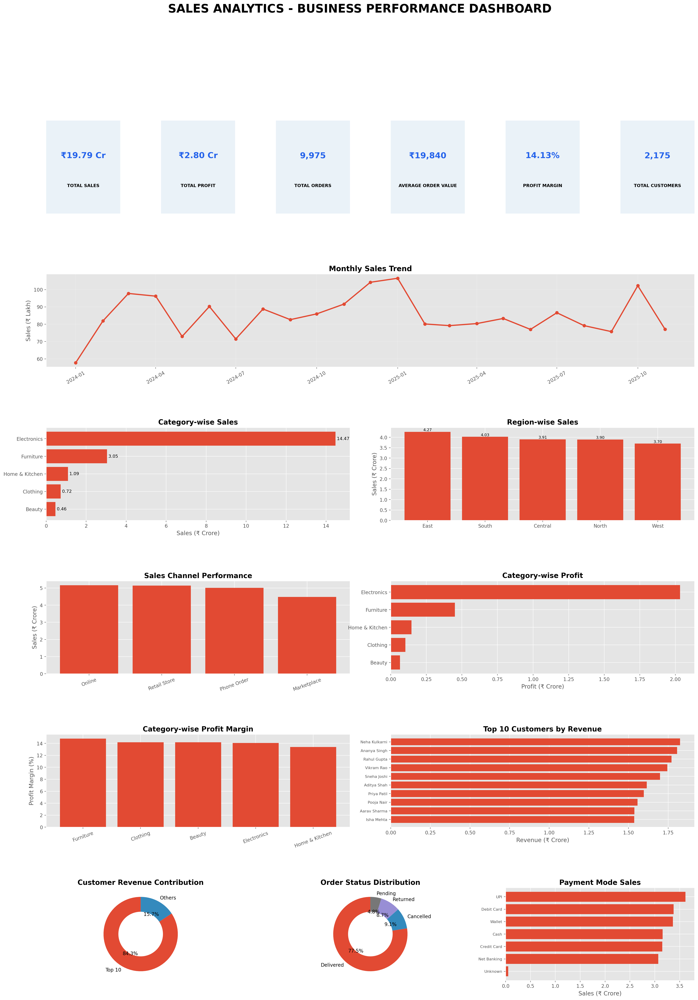
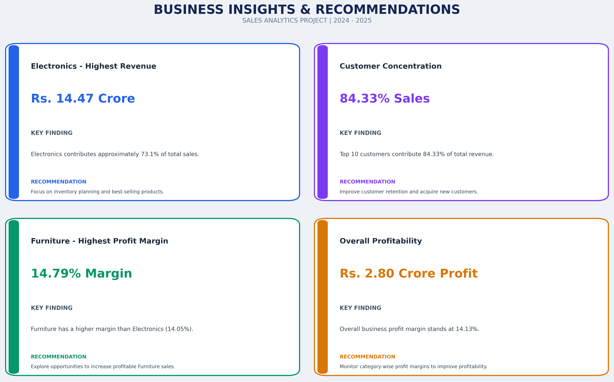

# 📊 Sales Analytics Project | Python

**An End-to-End Retail Sales Data Analysis Project**

A data analytics project focused on analyzing retail sales data, measuring business performance, identifying profitability trends, and generating actionable business insights using Python.

---

## 1. Project Overview

This project analyzes a retail sales dataset containing approximately 10,000 records to understand sales performance, customer behavior, regional performance, and business profitability.

The project involves data cleaning, preprocessing, exploratory data analysis (EDA), KPI calculations, and data visualization using Python.

The main objective is to transform raw sales data into meaningful insights that support data-driven business decisions.

## 2. Business Objectives

- Analyze overall sales and profit performance.
- Calculate important business KPIs.
- Identify top-performing product categories.
- Analyze regional and sales channel performance.
- Understand customer revenue contribution.
- Evaluate category-wise profitability.
- Generate actionable business recommendations.

## 3. Technologies & Tools

| Technology | Purpose |
|---|---|
| Python | Data analysis and processing |
| Pandas | Data cleaning and manipulation |
| NumPy | Numerical operations |
| Matplotlib | Data visualization and dashboards |
| Seaborn | Exploratory data visualization |
| Jupyter Notebook | Interactive development |
| Git & GitHub | Version control and project hosting |
| Excel | Dataset handling |

## 4. Project Workflow

1. Data Loading
2. Data Cleaning and Preprocessing
3. Missing Value Handling
4. Duplicate Detection and Removal
5. Data Type Correction
6. Feature Engineering
7. Exploratory Data Analysis (EDA)
8. Business KPI Calculations
9. Data Visualization
10. Business Insights and Recommendations
11. Dashboard and PDF Report Creation

## 5. Key Performance Indicators (KPIs)

| KPI | Result |
|---|---:|
| Total Sales | ₹19.79 Crore |
| Total Profit | ₹2.80 Crore |
| Total Orders | 9,975 |
| Average Order Value | ₹19,840.01 |
| Profit Margin | 14.13% |
| Total Customers | 2,175 |

## 6. Key Business Insights

### 1. Electronics – Highest Revenue
- Electronics generated approximately ₹14.47 Crore in sales.
- It contributed approximately 73.1% of total sales.
- Recommendation: Focus on inventory planning and best-selling products.

### 2. Customer Concentration
- Top 10 customers contributed 84.33% of total sales.
- Recommendation: Improve customer retention and expand the customer base.

### 3. Furniture – Highest Profit Margin
- Furniture achieved a profit margin of 14.79%.
- This was higher than Electronics at 14.05%.
- Recommendation: Explore opportunities to grow profitable Furniture sales.

### 4. Overall Profitability
- Total business profit was approximately ₹2.80 Crore.
- Overall profit margin was 14.13%.
- Recommendation: Monitor category-wise profitability to identify improvement opportunities.

## 7. Dashboard & Visualizations

The project includes Matplotlib-based dashboards and business insight visualizations.

### Sales Analytics Dashboard



### Business Insights & Recommendations



### Master Sales Analytics Dashboard

[View Master Dashboard](Dashboard/Master_Sales_Analytics_Dashboard.png)

## 8. Project Report

A PDF report containing the project overview, KPI summary, sales dashboard, business insights, and conclusion.

[📄 View Sales Analytics Project PDF Report](Reports/Sales_Analytics_Project_Report.pdf)

## 9. Project Structure

```text
Sales-Analytics-Project/
│
├── Dataset/
│   └── retail_sales_raw_10000_rows (1).xlsx
│
├── Notebooks/
│   ├── Sales_Analytics_Python.ipynb
│   └── Sales_Analytics_Visuals.ipynb
│
├── Dashboard/
│   ├── Sales_Analytics_Complete_Dashboard.png
│   ├── Business_Insights.png
│   ├── Business_Insights_Final.png
│   └── Master_Sales_Analytics_Dashboard.png
│
├── Reports/
│   ├── Business_Insights_and_Recommendations.md
│   └── Sales_Analytics_Project_Report.pdf
│
├── README.md
└── requirements.txt
```

## 10. How to Run the Project

### Step 1: Clone the Repository

```bash
git clone https://github.com/kunaalnikam/Sales-Analytics-Project.git
```

### Step 2: Navigate to Project Folder

```bash
cd Sales-Analytics-Project
```

### Step 3: Install Dependencies

```bash
pip install -r requirements.txt
```

### Step 4: Launch Jupyter Notebook

```bash
jupyter notebook
```

Open the notebooks available inside the `Notebooks` folder.

## 11. Key Learnings

- Data cleaning and preprocessing using Pandas.
- Handling missing values and duplicates.
- Data type conversion and feature engineering.
- Exploratory Data Analysis.
- Business KPI calculations.
- Customer and product performance analysis.
- Data visualization using Matplotlib.
- Business insights generation.
- Git and GitHub project management.

## 12. Author

**Kunal Ramesh Nikam**

Aspiring Data Analyst | Python | SQL | Power BI | Excel

[GitHub Profile](https://github.com/kunaalnikam)

[Sales Analytics Project Repository](https://github.com/kunaalnikam/Sales-Analytics-Project)

---

*This project was developed as part of my Data Analytics portfolio to demonstrate practical skills in Python-based data analysis, visualization, and business intelligence.*
